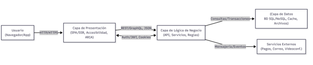
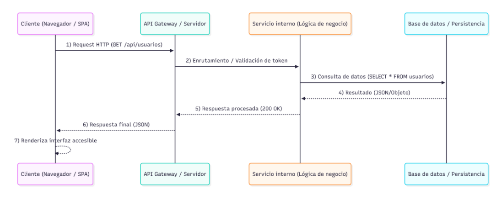

# Semana 8
* **Middleware:**  capa de software que actúa como puente entre diferentes aplicaciones, bases de datos, sistemas operativos y redes.
    - Es un backend
---
## Arquitectura N-Capas
1. Presentación: Se encarga de la interfaz del usuario e interacción visual
- Herramientas:
    - HTML5 semántico, CSS3 adaptable, JS ES6+, ARIA
2. Lógica de negocio: implementa reglas, procesos y controladores que definen como se comporta la aplicación.
- Herramientas:
    - API REST, servicios, middlewares, BFF 
3. Datos: Administra la persistencia, las consultas, los índices y las transacciones que garantizan la
coherencia de la información.
- Herramientas:
    - Esquemas SQL/NoSQL, migraciones, ORM, Redis
- Divide la aplicación en capas lógicas y funcionales
    - Se asigna a cada una de ellas responsabilidades específicas
- Mejora la escalabilidad, mantenimiento y seguridad del software
- Estas tres capas se expanden para incluir componentes adicionales, como API Gateway, capa de servicios compartidos, mensajería asincrónica, cachés distribuidos o sistemas de observabilidad
## Flujo entre capas

---
## Peticiones HTTP y respuestas (métodos, cabeceras, estado)
- El modelo de comunicación es solicitud/respuesta -> Asi funciona REST
- Petición HTTP:
    - Esta compuesta por 4 secciones principales:
        1. Línea de inicio: método, ruta y versión. ej: GET/api/usuarios HTTP/1.1
        2. Cabeceras: Se manda en el header por clave-valor con autenticación, tipo de contenido, cacheo, etc.
        3. Cuerpo: Datos de la solicitud en métodos como POST o PUT
        4. Una línea vacía final que marca el fin de la cabecera y el inicio del cuerpo
### Anatomía respuesta
- Tiene tres partes
    1. Línea de estado(status line): Versión, código y descripción(ej: HTTP/1.1 OK)
    2. Cabeceras: Metadatos de las respuestas
    3. Cuerpo: Datos solicitados o mensajes de error
## Métodos HTTP métodos CRUD
| Método | Acción | Descripción | Ejemplo |
| --- | --- | --- | --- |
| **GET** | Read | Solicita un recurso del servidor. No modifica datos. | `GET /api/usuarios` |
| **POST** | Create | Envía datos para crear un nuevo recurso. | `POST /api/usuarios` |
| **PUT** | Update | Reemplaza completamente un recurso existente. | `PUT /api/usuarios/3` |
| **PATCH** | Update parcial | Modifica solo ciertos campos de un recurso. | `PATCH /api/usuarios/3` |
| **DELETE** | Delete | Elimina un recurso específico. | `DELETE /api/usuarios/3` |
| **OPTIONS** | Meta | Devuelve los métodos permitidos sobre un recurso. | `OPTIONS /api/usuarios` |
---
## Códigos HTTP estandarizados
| Categoría | Rango | Descripción general | Ejemplos comunes |
| --- | --- | --- | --- |
| **1xx** | 100–199 | Respuestas informativas. | `100 Continue` |
| **2xx** | 200–299 | Éxito de la solicitud. | `200 OK`, `201 Created`, `204 No Content` |
| **3xx** | 300–399 | Redirecciones. | `301 Moved Permanently`, `304 Not Modified` |
| **4xx** | 400–499 | Errores del cliente. | `400 Bad Request`, `401 Unauthorized`, `404 Not Found` |
| **5xx** | 500–599 | Errores del servidor. | `500 Internal Server Error`, `503 Service Unavailable` |
--- 
## Cabeceras HTTP comunes
| Tipo | Cabecera | Descripción | Ejemplo |
| --- | --- | --- | --- |
| **General** | Date | Fecha y hora del mensaje HTTP. | `Date: Tue, 18 Feb 2025 14:00 GMT` |
| **De solicitud** | Authorization | Token o credenciales. | `Authorization: Bearer eyJh...` |
| **De solicitud** | Content-Type | Tipo de dato enviado. | `Content-Type: application/json` |
| **De respuesta** | Content-Length | Tamaño del cuerpo de respuesta. | `Content-Length: 1234` |
| **De respuesta** | Cache-Control | Políticas de almacenamiento. | `Cache-Control: no-cache` |
| **De respuesta** | Access-Control-Allow-Origin | Control de CORS. | `Access-Control-Allow-Origin: *` |
---
## Comunicación cliente servidor

---
## Principios modelo cliente servidor
1. **Separación de responsabilidades:** el cliente gestiona la interfaz y la experiencia
de usuario, mientras el servidor maneja la lógica y los datos
2. **Interoperabilidad:** capacidad de aplicaciones de conectarse con otras através de API's
3. **Independencia de plataforma:** el cliente puede ser una aplicación web, móvil o de escritorio; el servidor puede estar en la nube o en un servidor local.
4. **Escalabilidad:** la separación permite distribuir la carga entre varios servidores (balanceadores, microservicios).
    - Capacidad que tiene mi aplicación para añadir nuevas funcionalidades.
