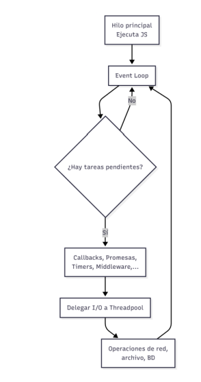
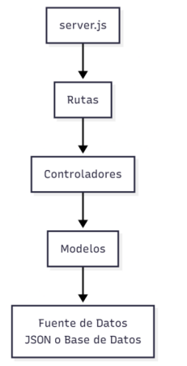

## Estilo arquitectónico
- Estamos utilizando n-capas, cliente-servidor, monolíticos
- El **patrón arquitectónico** que estamos utilizando es MVC(Modelo Vista Controlador)
- **Patrones de diseño:** Creaciones, comunicacionales
---
## Introducción a Node.js y EXPRESS
- Node.js y su framework es el más popular
- Es una buena práctica utilizar frameworks siempre que no se manejen datos sensibles, es decir por ejemplo si tenemos que hacer una interfaz bancaria es mejor ocupar C# en vez de nest.js o node.js
- Node.js funciona mediante "single-threaded, event-driven, non-blocking I/O"
- Tenemos el event loop:

- Hace que las aplicaciones del backend nunca fallen y que nunca se bloqueen entre sí
- **EXPRESS**
    - Framwork más utilizado en node.js
    - Nos permite trabajar con el patrón arquitectónico MVC
    - Provee herramientas para crear servidores HTTP de forma rápida, implementar middleware, etc.
    - Funciona con rutas que son manejadas por el controlador, instalamos el controlador con el framework de EXPRESS´
- **Manejo de JSON y transporte de datos**
    - El protocolo por default para transportar datos en REST es JSON
        - Ocupamos JSON cuando quiero enviar o recibir datos
    - Podemos cambiar el tipo de datos
    - Para REST todo lo que está en la nube y se puede acceder através de una URL es un recurso
        - Gracias a esto existe el cloud computing
    - REST es lo más usado cuando se utilizan API's que reciben y envían datos
    - Ahora es un estándar que la ruta tenga `api`/pedidos, para que sepamos que es una api
    - Métodos son las acciones que llegan desde el lado del cliente para que la API sepa que hacer
        - GET
        - POST
        - PUT 
        - PATCH
        - DELETE
    - Si el usuario no especifica la acción por defecto es GET
    - Tenemos que configurar el content-type para que el servidor decida que tipo de datos enviar, JSON, JPG, etc.
    - El cliente también debe tener en su cabecera el content-type
## Estructura de proyecto
- Rutas
- Controladores
- Modelos
- Para cumplir MVC:

- La responsabilidad de una ruta es mapear un endpoint HTTP a su controlador

## Tipos de Middleware
- El middleware maneja la parte de seguridad, es decir que analiza las peticiones y las valida antes de pasar al controlador, en caso de que un usuario no esté autorizado, la petición no la pasa al controlador
1. Middleware de CORS
- Controla qué cliente puede acceder a la API.
`res.header("Access-Control-Allow-Origin", origin);`
2. Middleware de correlación
- Genera un ID único por solicitud útil para debugging.
`req.correlationId = "cid-abc123";`
3. Middleware de contexto de usuario
- Inserta req.user basado en encabezados enviados por el frontend.
`req.user = { id: Number(id), rol };`
- No solo es autenticación si no también autorización